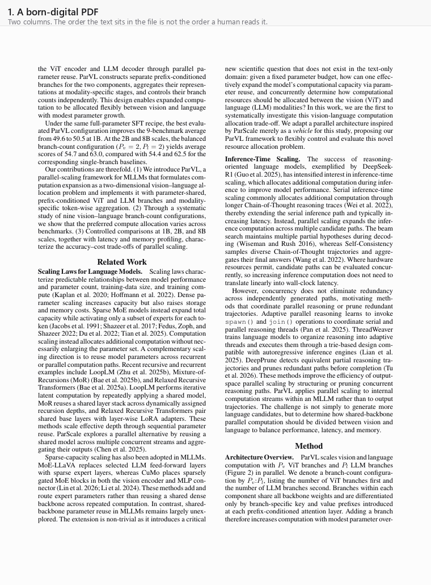

<h1 align="center">DocStruct</h1>

<p align="center">
  <strong>Local, deterministic, structure-aware PDF chunking for RAG.</strong>
</p>

<p align="center">
  
</p>

<p align="center">
  <sub>A real page through the real pipeline — every box above is a
  <code>run_pipeline()</code> result, not a mock-up.
  Regenerate with <code>python scripts/make_readme_gif.py &lt;pdf&gt; --page 1</code>.</sub>
</p>

<p align="center">
  <a href="#results">Results</a> ·
  <a href="#install">Install</a> ·
  <a href="#quickstart">Quickstart</a> ·
  <a href="#how-it-works">How it works</a> ·
  <a href="#evaluation">Evaluation</a> ·
  <a href="docs/API.md">API</a> ·
  <a href="paper/">Paper</a> ·
  <a href="gpt.md">Project overview</a>
</p>

<p align="center">
  
  
  
</p>

---

DocStruct turns born-digital PDFs into retrieval-ready chunks that respect document
structure. It runs two **independent** layout detectors — a rules-based geometry pass
over pdfplumber primitives, and an optional YOLOv8/DocLayNet vision model — reconciles
them with a deterministic fusion algorithm, orders the result into real reading order,
and emits chunks annotated with their section path.

Three properties define the project:

- **No LLM calls in the pipeline.** Same PDF in → same chunks out (measured: 95/95
  documents byte-identical across independent processes).
- **Fully local.** No API, no internet at parse time. Runs air-gapped.
- **Structured output.** Bounding boxes, per-source confidence, reading order and
  section hierarchy — so retrieval can be filtered (`where={"h1": "3. Methodology"}`).

Naive chunking splits on token counts, which destroys exactly the structure that makes
a document navigable: tables split mid-row, captions detach from figures, headers
orphan from their bodies. DocStruct detects layout first and chunks along document
boundaries instead.

| Compared with | DocStruct's difference |
|---|---|
| LangChain recursive splitter | respects structure; carries section-path metadata |
| Unstructured.io / LlamaParse | fully local, free, deterministic, section-filtered retrieval |
| pymupdf4llm | tied under span relevance (p=0.23), ahead under region; similar context per query |

## Results

The embedder and both retrievers are **held constant across every tool** — only the
chunker varies — so the tables below measure chunking and nothing else.

### The headline, and the catch: the relevance rule decides the winner

OHR-Bench: 95 born-digital documents, **3,558 human-authored questions**, seven
chunkers. All three columns are scored on **identical chunks** — only the rule that
decides "is this chunk relevant?" changes.

| Tool | `page` | `span` | `region` | ctx words |
|---|---|---|---|---|
| **docstruct** | 0.600 (6th) | **0.706 (1st)** | **0.666 (1st)** | 2194 |
| docstruct_geo | 0.470 (7th) | 0.705 (2nd) | 0.657 (2nd) | 2328 |
| pymupdf4llm | 0.668 | 0.699 (3rd) | 0.604 (3rd) | 2424 |
| unstructured | **0.795 (1st)** | 0.654 | 0.601 | **561** |
| langchain | 0.756 | 0.641 | 0.603 | 638 |
| llamaindex | 0.729 | 0.648 | 0.589 | 1430 |
| llamaindex_semantic | 0.652 | 0.654 | 0.575 | 4698 |

**We are 1st of 7 under two rules and 6th of 7 under the third.** No relevance rule
is neutral to chunk size: `span` rewards large chunks, `page` rewards small ones, and
unstructured wins `page` with the smallest chunks in the field. A leaderboard that
reports one rule reports a ranking and a size preference at the same time.

Context volume matters here. DocStruct hands the retriever 2,194 words per query and
unstructured 561, so part of our `span` lead may come from returning more text. Across
the seven tools, chunk size and MRR correlate at +0.57 under `span`, −0.68 under `page`
and +0.04 under `region` (n=7, none significant), which is why `region` is the rule we
lead with. At a matched budget the lead holds: raising the baselines' top-k until their
context matches `docstruct_geo` (2,328 words; unstructured k=20, langchain k=17,
llamaindex k=8) leaves `docstruct_geo` ahead by 0.043–0.060 MRR under `span` and
0.047–0.064 under `region`, every paired 95% interval above zero. Unstructured at k=20
does recall more answers under `span` (0.800 against 0.789). Numbers in
[`reports/budget/summary.md`](reports/budget/summary.md).

We could find no prior chunking evaluation that varies the rule, so we publish all
three. Read [`gpt.md` §4.2 and §6.1](gpt.md) before quoting
any row.

The `region` threshold of 0.7 was fixed before any scoring, and it is also where our
margin peaks. Swept from 0.1 to 1.0, a DocStruct variant is 1st at all ten thresholds
([`reports/ohr_region_threshold_sweep.json`](reports/ohr_region_threshold_sweep.json)),
but the hybrid leads only from 0.6 up; below that the geometry-only variant does.

### Section boundaries, with no retriever involved

Do the chunk boundaries land where the *document's own* boundaries land? Scored
against section boundaries the publishers wrote in JATS XML for **134 PubMed Central
papers** — gold that predates this project and was written for an unrelated purpose.
Pk and WindowDiff are **error** rates; lower is better.

| Tool | WindowDiff | Pk | Chunks | Docs |
|---|---|---|---|---|
| **docstruct_geo** | **0.4226** | **0.3418** | 26.8 | 134 |
| pymupdf4llm | 0.4800 | 0.4490 | 17.7 | 134 |
| **docstruct** | 0.4818 | 0.3531 | 37.5 | 134 |
| llamaindex_semantic | 0.5337 | 0.5128 | 29.1 | 134 |
| llamaindex | 0.6952 | 0.5979 | 42.7 | 134 |
| langchain | 0.8787 | 0.6200 | 85.6 | 134 |
| unstructured | 0.8933 | 0.6025 | 106.9 | **99** |

No embedder, no relevance rule, nothing of ours in the gold. Two caveats: WindowDiff
punishes over-segmentation, so read it beside Pk; and unstructured's row covers 99 of
134 documents because it hard-failed on 35 (26%). Also, 57% of the gold sections are
shorter than our 200-word chunk floor, so DocStruct merges them by design.

Against a chance floor that places N boundaries at random
([`scripts/section_random_baseline.py`](scripts/section_random_baseline.py), 122 docs),
DocStruct leads by +0.16 to +0.18 Pk — and **five of the seven chunkers do not clearly
beat random placement at their own chunk count**. The floor and the tool table are
currently computed on different document subsets, so the direction is safe and the
exact margin is not yet quotable.

### What we lose

- **Coverage and duplication.** On OHR-Bench, DocStruct keeps 0.9632 of the document's
  word instances at 1.8322× duplication, against LangChain's 1.000 / 1.1005. LangChain
  splits raw text and drops nothing; our duplication comes from inline headers and
  separately emitted table chunks. We win *retrieval*, not raw preservation.
- **Context cost.** We retrieve 2,194 words per query against unstructured's 561 —
  they are 3.63× more efficient on MRR per 1k context words. We win accuracy and lose
  token cost.
- **Academic is our weakest domain** in every relevance mode (span 0.4526, 5th of 7).
  We win overall by winning law and manuals.
- **The vision detector does not pay for itself outside arXiv.** On OHR-Bench it is
  worth +0.0012 span (p=0.80) and +0.0090 region (p=0.12) — not significant. On PMC
  section boundaries, geometry-only *beats* the hybrid at 2.4× the speed.

Full runs with per-document breakdowns, paired-significance tables, extraction
fidelity and the config snapshot behind each: [`reports/`](reports/). The write-up is
[`paper/main.tex`](paper/main.tex); corpora and checksums are
[`datasets/`](datasets/); what was tried and abandoned is [`notes.md`](notes.md).

**Known defects, recorded rather than fixed quietly:** a layout block spanning both
columns can have its text extracted across the gutter, interleaving the columns into
an unreadable section heading; and full-width elements above a two-column body — a
title, an author block — sort after the columns rather than before. Both found by
drawing the pipeline's real output (`notes.md` Stage 22), both open in
[`ROADMAP.md`](ROADMAP.md).

## Install

```bash
pip install docstruct-rag
```

The distribution is **`docstruct-rag`** — `docstruct` was already taken on PyPI. The
import name is unchanged. Core install pulls two dependencies (`pdfplumber`, `numpy`)
and needs no network at parse time; everything else is an extra:

```bash
pip install "docstruct-rag[model]"        # YOLOv8/DocLayNet vision detector
pip install "docstruct-rag[langchain]"    # doc.to_langchain()
pip install "docstruct-rag[llamaindex]"   # doc.to_llamaindex()
pip install "docstruct-rag[all]"          # everything incl. benchmark tooling
```

## Quickstart

```python
import docstruct

doc = docstruct.parse("paper.pdf")                       # geometry-only, offline
doc = docstruct.parse("paper.pdf", weights="weights/yolov8m-doclaynet.pt")
doc = docstruct.parse("locked.pdf", password="secret")

doc.text            # whole document in reading order
doc.markdown        # headings, tables and captions preserved
doc.sections()      # ["1. Introduction", "2. Method > 2.1 Setup", ...]
doc.chunks          # retrieval-ready units, each with .chunk_type / .section_path
doc.tables          # [(grid, page_num, section_path), ...]
doc.to_json("chunks.json")
```

Failures raise a typed hierarchy (`DocStructError`, `InvalidPDFError`,
`EncryptedPDFError`) so you never catch pdfminer internals. Scanned PDFs parse but
flag themselves in `doc.diagnostics["likely_scanned"]` — DocStruct is born-digital
only; run a deterministic OCR pass (e.g. `ocrmypdf`) first.
`parse(..., cache_dir=".cache")` caches detector output and populated blocks by PDF
content hash.

**Full API reference, including retrieval and the CLI: [`docs/API.md`](docs/API.md).**

```bash
docstruct run paper.pdf --format md --out paper.md     # or text / json
docstruct index a.pdf b.pdf --db .chroma
docstruct query "results" --db .chroma --h1 "4. Experiments" --hybrid
docstruct visualize paper.pdf --out annotated.pdf      # inspect detections
```

## How it works

```
PDF
 ├─ geometry/detector.py   pdfplumber rules ─┐  (blind to the model)
 ├─ model/detector.py      YOLOv8/DocLayNet ─┤  (optional, blind to geometry)
 │                                           ▼
 │                         fusion/matcher    greedy IoU match + priority NMS
 │                         fusion/arbiter    confirmed vs disputed (label)
 │                         fusion/fusion     → List[Block] + ConfidenceBreakdown
 ├─ reading_order.py       columns + top→bottom; caption → figure/table
 ├─ extraction/            block text + table grids (font-scaled word spacing)
 ├─ chunking/              header levels by font rank → section-aware chunks,
 │                         with a minimum-size floor on structural boundaries
 ├─ indexing/              sentence-transformers → ChromaDB
 └─ query/                 top-k chunks + section-path citations
```

Both detectors run fully independently and never see each other's output. All
reconciliation happens in `fusion/`. That independence is what makes the confidence
scores meaningful — agreement between two uncorrelated observers, rather than one
model's softmax renamed.

| Fusion case | Condition | Final confidence |
|---|---|---|
| Confirmed | both detect, same label, IoU ≥ 0.35 | `0.85 + 0.10·model_conf + 0.05·IoU` |
| Disputed | both detect, different label, IoU ≥ 0.35 | `winner_conf × 0.85` |
| Unilateral | one detector only | source-scaled and bounded (see `config.py`) |

**The chunk-size floor**: a structural boundary only *ends* a chunk once it already
holds `MIN_CHUNK_TOKENS` (200) words. Without it, a page of prose interleaved with three
figures becomes four tiny chunks that rank poorly. The 200/500 bounds were chosen on an
internal corpus whose gold was later withdrawn, and have not been re-tuned on a public
benchmark yet.

Coordinates are **top-left** throughout (`y0` = top, y increasing downward), matching
pdfplumber, so geometry, model (after a pixel→point transform), extraction and
visualization share one space. Chunk sizes are counted in whitespace words, not
tokenizer tokens — a real tokenizer would tie chunk boundaries to a model version and
break "same PDF in → same chunks out". All thresholds live in `config.py`, each with a
comment naming the measurement that chose it; values inherited from the v0 prototype
are flagged `# unvalidated`.

Deeper detail: [`gpt.md` §3](gpt.md).

## Evaluation

Three layers in `docstruct.eval`, answering different questions:

- **Retrieval** — MRR / NDCG@k / Recall@k / Hit@1, plus context cost and paired
  bootstrap significance, against six other chunkers. Relevance is selectable
  (`--relevance span|region|page`) because **one rule does not fit three corpora**.
- **Section boundaries** — Pk and WindowDiff against publisher-authored JATS, with no
  embedder and no relevance rule involved (`scripts/score_sections.py`).
- **Extraction fidelity** — coverage and duplication against raw pdfplumber text. No
  gold, no LLM; the document is its own reference, so it runs on any corpus.

Gold is never generated from the output of a tool being benchmarked. Our own
`(question, verbatim span)` generator reads each PDF's **raw text**
(`eval/qa_generator.py`, the only place this project talks to an LLM), and the
headline corpora use human-authored gold instead.

### Reproducing the benchmark

```bash
python scripts/fetch_ohrbench.py                        # 95 docs, 3,558 human Q

python -m docstruct.cli benchmark \
  --pdfs-dir data/ohrbench --qa data/qa/ohrbench.json \
  --relevance span --weights weights/yolov8m-doclaynet.pt \
  --cache-dir .bench_cache \
  --report-md reports/run.md --report-json reports/run.json
```

Run it once per relevance mode. DocStruct's block cache makes modes 2 and 3 cheap for
DocStruct; the baselines re-chunk every run. Before any
new corpus's first leaderboard, run `scripts/gold_reachability.py` — it reports what
fraction of the gold each rule can reach at all, identically for every tool, and warns
when the question is circular.

```bash
python scripts/fetch_pmc.py --per-journal 2 && python scripts/score_sections.py
python scripts/coverage_report.py                       # extraction fidelity only
python scripts/ablate.py --name min300 --set MIN_CHUNK_TOKENS=300
```

`ablate.py` runs one adapter with `config` overrides applied, so a single chunking
change is measured without re-running the unaffected baselines. Method, traps and the
full protocol: [`gpt.md` §4](gpt.md).

## Scope and limitations

- **In scope:** born-digital, prose-structured PDFs — papers, reports, manuals, books.
- **Out of scope:** scanned documents (no OCR, by design), slide decks,
  forms/invoices.
- Borderless tables are caught by the model, not by geometry (`find_tables` is
  ruled-line based) — a concrete motivation for the hybrid design.
- Geometry-only hierarchy is font-driven, so it can conflate title, author and section
  headers.
- Rotated and margin text is filtered out of the reading flow.
- **Every number above comes from one retrieval configuration** (`all-MiniLM-L6-v2` +
  BM25 + RRF, k=5). Whether the relevance-rule inversion survives other encoders is
  the open question gating publication.
- The determinism measurement is geometry-only; the hybrid path goes through CUDA,
  which is not guaranteed bit-reproducible.
- **The internal arXiv corpus and every number measured on it are withdrawn** — a
  re-fetch reused `docN.pdf` filenames for different papers, so its gold no longer
  matches its PDFs (`notes.md` Stage 24). Gold is being regenerated.

## Project layout

```
docstruct/          the library (geometry, model, fusion, chunking, eval, cli)
tests/              pytest suite, 227 tests
scripts/            corpus fetching, scoring, and the single-tool ablation runner
tools/annotate.html browser UI for correcting detection ground truth
reports/            benchmark reports, each with its full config snapshot
paper/              the ACL submission (main.tex + refs.bib)
notes.md            chronological engineering log
gpt.md              whole-project overview: aim, design, evaluation, findings
ROADMAP.md          current work queue
```

## Development

```bash
pip install uv
uv venv && uv pip install -e ".[all]"
uv run pytest -q                                     # 227 tests, ~4 min
```

Tests that need optional extras, real PDFs or an LLM self-skip when those are absent,
so the suite stays green on a bare core install.

Contributions are welcome, with one standing rule: **any change to chunking, reading
order or extraction must be measured** with `scripts/ablate.py` against the numbers in
`reports/` before it is claimed as an improvement.
Several elegant changes in this project's history measured worse and were turned off;
that is recorded in [`gpt.md` §7](gpt.md) and [`notes.md`](notes.md) so nobody re-proposes
them blind.

## License

MIT — see [LICENSE](LICENSE).
